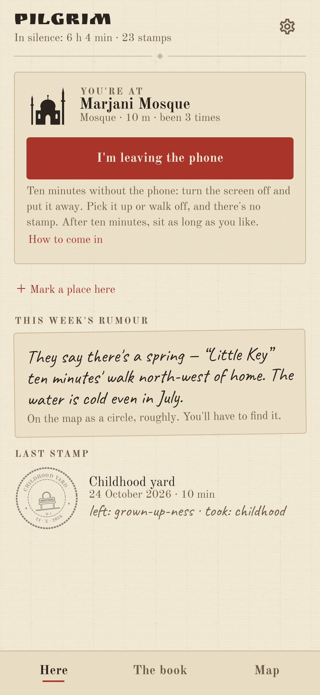
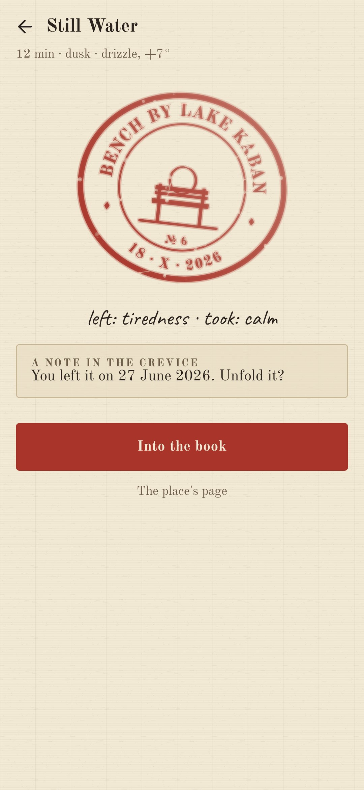
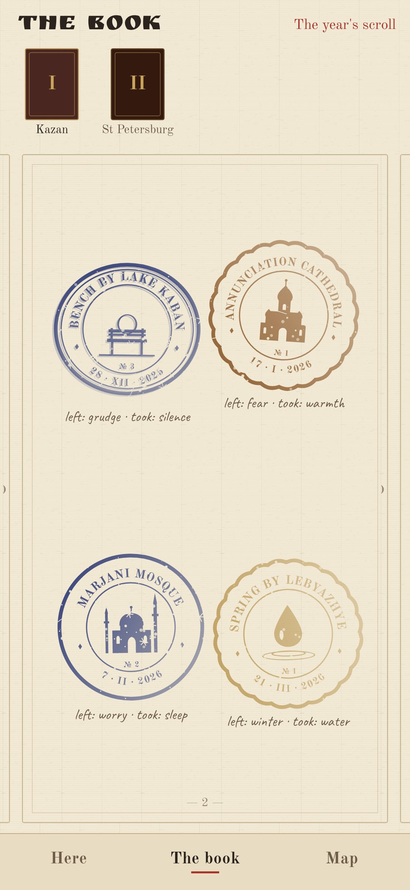
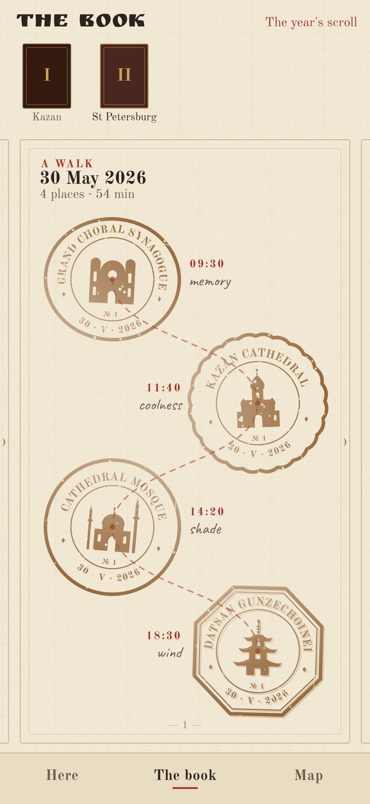

<div align="center">


# Pilgrim

### A pilgrim's pass: a stamp for ten minutes at a place of power.

*Pilgrims carried a little book that was stamped at every holy place they reached. Pilgrim is that book. Come to a church, a mosque, a synagogue, a temple, a spring, an old tree, a stone, a height. Sit there ten minutes without the phone (the screen and your location check it) and the book gets a stamp nobody else has: its ink from where the sun was, its marks from the weather. Free, no ads, no account.*

[](https://github.com/bigdevwhale/pilgrim/actions/workflows/android.yml)


[](LICENSE)

**English** · [Русский](README.ru.md) · [Changelog](CHANGELOG.md)

    

</div>

---

## How it works

1. **Come to a place.** The common map ([OpenStreetMap](https://www.openstreetmap.org)) knows houses of worship of every faith, wayside chapels, springs, protected trees, named stones, peaks and viewpoints. When you're within a place's radius, the book says so.
2. **Leave the phone.** Tap the button, turn the screen off and put the phone away. The time runs only while the screen is dark. A glance at a notification is forgiven; ten seconds of a lit screen means the phone was picked up. Walk away from the place, or walk with the phone for a minute, and the sitting ends. A faked location never counts. After ten minutes the stamp is yours: two soft pulses, and you may stay as long as you like.
3. **Two words.** *What did you leave here? What did you take?* One word each, then the stamp comes down.
4. **No two stamps alike.** The frame belongs to the place (round, oval, octagonal or scalloped), the silhouette to its kind, the number to your visit. The ink is gold at dawn, ochre by day, cinnabar at sunset, indigo at night. Rain bleeds it, snow leaves frost, wind smears a second strike, fog fades it. Twenty minutes add a ring, forty a ring of beads.
5. **A note in the crevice.** Leave a note at a place. It opens only there, on another day, after ten minutes.
6. **A place of your own.** Not on the map? Mark it: from a good GPS fix only, not within 300 m of home, two a week. It goes in pencil and is inked on your third day there. If it's a spring or a chapel, you can then leave an anonymous note for the OpenStreetMap mappers.
7. **The point is off?** A place on the map whose point isn't where it really is can be tied to where you stand, for your book only.
8. **This week's rumour.** The book never shows the whole map. Once a week it tells of one place nearby, the way people do: "They say there's a spring ten minutes' walk north-west of home…". On the map it's a circle with a question mark in it.
9. **The year's circle.** Sit at a place in winter, spring, summer and autumn and the circle closes; give the place a name of your own.
10. **Walks.** Three or more places in a day make a walk: a page of its own, the stamps on one thread.
11. **Notebooks and the scroll.** Home's places fill the first notebook; each faraway town starts another, with its own leather cover. The year's scroll rolls up the time in silence, the walks, a small map of each town and every pair of words.
12. **How to come in.** Before the first sitting at each kind of place, a few short lines on how to come in. The same even tone for every faith; no symbols of faith anywhere, only buildings and nature.

Home is found without asking: where the phone is at night when you open the app. Nothing leaves the phone but a rounded point, sent to Overpass (places nearby) and Open-Meteo or MET Norway (the weather on the stamp). Words, notes and home stay with you.

## Build

```
./gradlew testDebugUnitTest assembleDebug
./gradlew -Pdemo assembleDebug          # app.pilgrim.demo with a year in Kazan and a walk in St Petersburg
./gradlew testDebugUnitTest -Prender --tests '*RenderArt*'   # the stamp sheet, the icon and every screen to app/build/art
python tools/shots.py app/build/art     # README screenshots from the renders
python tools/icon.py                    # the launcher icon vectors
```

The stamps are inked in code (`ui/art/StampArt.kt`). The sitting's rules are `domain/SitRules.kt`, kept running with the screen off by a foreground service (`sit/SitService.kt`).

Fonts: [Old Standard TT](https://fonts.google.com/specimen/Old+Standard+TT), [Ruslan Display](https://fonts.google.com/specimen/Ruslan+Display) and [Caveat](https://fonts.google.com/specimen/Caveat), SIL Open Font License. Map data © OpenStreetMap contributors.
