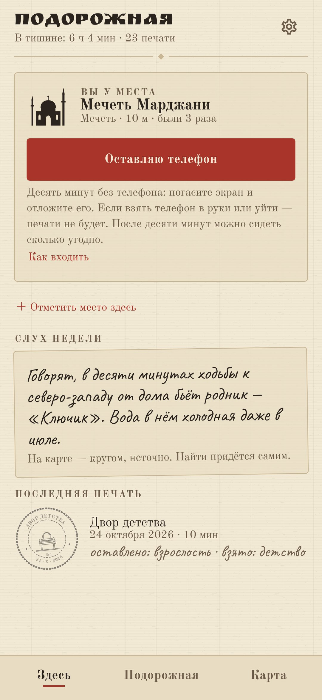
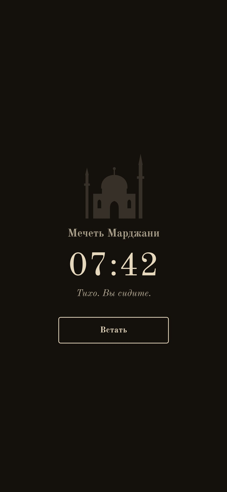
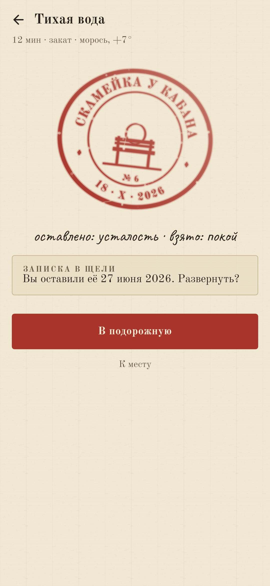
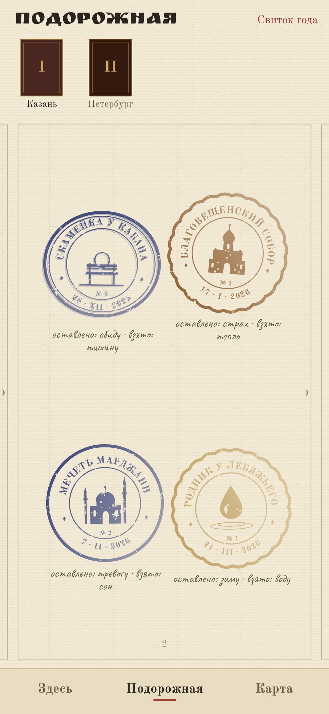
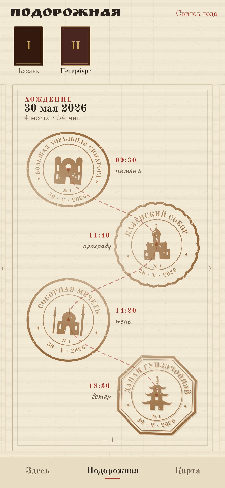

# Подорожная

### Книжка паломника: печать за десять минут в месте силы.

*У паломников была книжечка, куда в каждом святом месте ставили печать. «Подорожная» — такая книжечка. Приходите в церковь, мечеть, синагогу, храм, к роднику, старому дереву, камню, на высоту. Посидите там десять минут без телефона — это проверяется по экрану и геолокации — и получите печать, какой больше нет ни у кого: цвет чернил от солнца, следы от погоды. Бесплатно, без рекламы и без аккаунта.*

[English](README.md) · **Русский** · [Изменения](CHANGELOG.md)

    

---

## Как это устроено

1. **Придите к месту.** Общая карта ([OpenStreetMap](https://www.openstreetmap.org)) знает храмы всех вер, придорожные часовни, родники, охраняемые деревья, камни с именами, вершины и смотровые. Когда вы в радиусе места, подорожная это видит.
2. **Оставьте телефон.** Нажмите кнопку, погасите экран и отложите телефон. Время идёт, только пока экран тёмный. Взглянуть на уведомление можно; десять секунд горящего экрана — значит, телефон взяли в руки. Отойдёте от места или минуту проходите с телефоном — сеанс прервётся. Подменённая геолокация не засчитывается никогда. После десяти минут печать ваша: два мягких толчка — и можно сидеть сколько угодно.
3. **Два слова.** *Что вы оставили здесь? Что взяли с собой?* По одному слову — и печать опускается.
4. **Двух одинаковых нет.** Рамка — от места (круглая, овальная, восьмиугольная, зубчатая), силуэт — от его вида, номер — от визита. Чернила золотые на рассвете, охра днём, киноварь на закате, индиго ночью. Дождь их размывает, снег оставляет иней, ветер — второй смазанный оттиск, туман бледнит. Двадцать минут добавляют кольцо, сорок — кольцо бусин.
5. **Записка в щели.** Оставьте у места записку. Откроется только здесь, в другой день, после десяти минут.
6. **Своё место.** Нет на карте? Отметьте сами: только по точному GPS, не ближе 300 м от дома, не больше двух в неделю. Оно ляжет карандашом и станет чернильным на третий день. Если это родник или часовня — можно оставить анонимную заметку картографам OpenStreetMap.
7. **Точка не там?** Место с карты, чья точка не совпадает с настоящей, можно привязать к тому, где вы стоите, — только в вашей подорожной.
8. **Слух недели.** Карту целиком подорожная не показывает. Раз в неделю она рассказывает про одно место рядом, как рассказывают люди: «Говорят, в десяти минутах ходьбы к северо-западу от дома бьёт родник…». На карте — круг с вопросом.
9. **Круг года.** Посидите у места зимой, весной, летом и осенью — круг замкнётся, и место получит ваше имя.
10. **Хождения.** Три места и больше за день — хождение: отдельная страница, печати на одной нити.
11. **Тетради и свиток.** Места у дома — первая тетрадь; каждый дальний город начинает новую, со своей кожаной обложкой. Свиток года сворачивает время в тишине, хождения, маленькие карты городов и все пары слов.
12. **Как входить.** Перед первым сеансом у каждого вида мест — несколько коротких строк о том, как входить. Ровный тон для всех вер, никаких символов веры: только здания и природа.

Дом подорожная находит сама — по тому, где телефон бывает ночью, когда вы открываете приложение. С телефона уходит только округлённая точка: в Overpass (места рядом) и Open-Meteo или MET Norway (погода на печати). Слова, записки и дом остаются у вас.
